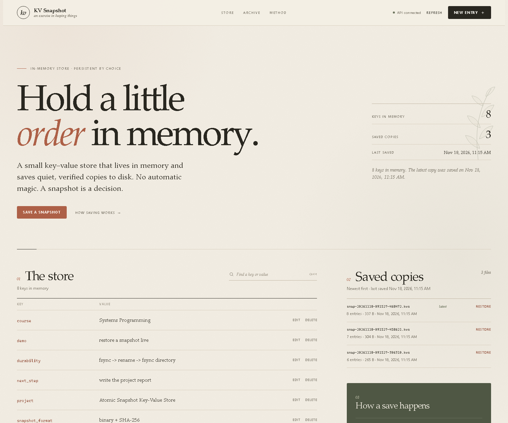

# KV Snapshot — Atomic Key–Value Store

[](https://github.com/seifmomo/kv-snapshot/actions/workflows/ci.yml)
[](https://www.python.org/)
[](#)
[](#testing)
[](LICENSE)

A crash-safe, in-memory key–value store with **atomic snapshot files**, a
**SHA-256 integrity check**, a browser dashboard, a small REST API, and a CLI.
Built for a Systems Programming team project with the Python standard library
only — no Flask, no database, no external packages.



## Why this project is interesting

The data lives in memory, so reads and writes are fast and simple. Durability
comes from a carefully ordered snapshot protocol:

1. Serialize a **consistent copy** of the store.
2. Write to a temporary file in the **same directory**.
3. Flush and `fsync` the file.
4. `os.replace()` the temp file to its final unique name (atomic on one
   filesystem).
5. On POSIX, `fsync` the directory so the rename itself is durable.

Restoring is just as careful: read the complete file, verify its magic,
version, lengths, and SHA-256 checksum, parse it into a **new** dictionary, and
only then swap it into the live store. A corrupt file can never partially
damage live data.

## Features

- Thread-safe in-memory store (`threading.Lock`)
- Binary snapshot format with magic bytes, version, entry count, and SHA-256
- Atomic write: same-directory temp file → `fsync` → `rename` → directory `fsync`
- Safe restore: verify everything before touching live state
- Path-traversal protection for snapshot names
- Stale `.tmp` cleanup on startup
- Browser dashboard (vanilla HTML/CSS/JS)
- REST API using `http.server` only
- Interactive CLI for a terminal demo
- 72 unit, integration, and failure-injection tests
- GitHub Actions CI on Ubuntu and Windows

## Quick start

Requires **Python 3.10+**. There is nothing to install.

```bash
# from the project folder
python -m kvstore --demo --open
```

Open <http://127.0.0.1:8080> if the browser does not open automatically.

Without demo data:

```bash
python -m kvstore
```

Restore the newest snapshot when the server starts:

```bash
python -m kvstore --load-latest
```

Useful options:

| Option | Meaning |
| --- | --- |
| `--host 127.0.0.1` | Bind address (default: localhost only) |
| `--port 8080` | TCP port |
| `--data-dir snapshots` | Folder for `.kvs` files |
| `--load-latest` | Restore newest snapshot before serving |
| `--demo` | Add sample entries if the store is empty |
| `--open` | Open the dashboard in your browser |

## CLI

```bash
python -m kvstore.cli --data-dir snapshots
```

```text
kv> set greeting "hello from the CLI"
created
kv> get greeting
hello from the CLI
kv> snapshot
created snap-20261118-111500-123456.kvs (1 entries, 118 bytes)
kv> snapshots
kv> restore snap-20261118-111500-123456.kvs
restored 1 entries
```

Type `help` inside the CLI for all commands.

## Tests

```bash
python -m unittest discover -s tests -v
```

The suite covers:

- store validation and concurrent readers/writers
- binary format round-trips and every malformed-file branch
- REST CRUD, validation, snapshots, restore, and path traversal
- disk-full (`fsync` failure) and rename failure
- corruption/truncation with live state unchanged
- stale temp-file cleanup
- serialized concurrent snapshots and point-in-time consistency

Current result: **72 tests passing**.

## API

Base URL: `http://127.0.0.1:8080`

| Method | Path | Purpose |
| --- | --- | --- |
| `GET` | `/api/health` | Liveness check |
| `GET` | `/api/status` | Counts, data directory, latest snapshot |
| `GET` | `/api/entries` | List all entries |
| `GET` | `/api/entries/{key}` | Read one entry |
| `POST` | `/api/entries` | Create/update: `{"key":"…","value":"…"}` |
| `DELETE` | `/api/entries/{key}` | Delete one entry |
| `GET` | `/api/snapshots` | List snapshot files |
| `POST` | `/api/snapshots` | Create a snapshot |
| `POST` | `/api/restore` | Restore: `{"file":"snap-….kvs"}` |

All responses use `{"ok": true, …}` or
`{"ok": false, "error": {"code": "…", "message": "…"}}`.
Validation errors return `400`, missing keys/files `404`, corrupt snapshots
`422`, and unexpected storage failures `500`.

Example:

```bash
curl -X POST http://127.0.0.1:8080/api/entries \
  -H "Content-Type: application/json" \
  -d '{"key":"owner","value":"Seif"}'

curl -X POST http://127.0.0.1:8080/api/snapshots
curl http://127.0.0.1:8080/api/snapshots
```

## Snapshot file format (`KVSN` v1)

All integers are big-endian.

| Offset | Size | Field |
| --- | --- | --- |
| 0 | 4 | Magic `KVSN` |
| 4 | 1 | Version (`1`) |
| 5 | 3 | Reserved padding |
| 8 | 4 | Number of entries |
| 12 | … | Entries |
| end−32 | 32 | SHA-256 of all preceding bytes |

Each entry:

| Size | Field |
| --- | --- |
| 2 | Key length in bytes |
| 4 | Value length in bytes |
| key length | UTF-8 key |
| value length | UTF-8 value |

Limits: key ≤ 256 bytes, value ≤ 64 KiB, at most 100,000 entries per snapshot.

## Project structure

```text
kv-snapshot/
├── kvstore/
│   ├── store.py          # thread-safe in-memory map + validation
│   ├── snapshot.py       # format, checksum, atomic writer, safe restore
│   ├── server.py         # http.server API + static dashboard
│   ├── cli.py            # interactive terminal client
│   └── web/              # index.html, style.css, app.js
├── tests/
│   ├── test_store.py
│   ├── test_snapshot.py
│   ├── test_api.py
│   └── test_failure_modes.py
├── docs/
│   ├── KV-Snapshot-Project-Report.pdf
│   ├── KV-Snapshot-Code-Discussion-Guide.pdf
│   ├── KV-Snapshot-Presentation.pptx
│   ├── REPORT.md / CODE_GUIDE.md / TEAM.md / API.md / DEMO.md
│   └── images/
├── .github/workflows/ci.yml
├── run.py
└── requirements.txt      # intentionally empty (stdlib only)
```

## Documentation

- **Project report (PDF):** [`docs/KV-Snapshot-Project-Report.pdf`](docs/KV-Snapshot-Project-Report.pdf)
- **Code discussion / viva guide (PDF):** [`docs/KV-Snapshot-Code-Discussion-Guide.pdf`](docs/KV-Snapshot-Code-Discussion-Guide.pdf)
- **Presentation:** [`docs/KV-Snapshot-Presentation.pptx`](docs/KV-Snapshot-Presentation.pptx)
- **Demo script:** [`docs/DEMO.md`](docs/DEMO.md)
- **API contract:** [`docs/API.md`](docs/API.md)
- **Team roles:** [`docs/TEAM.md`](docs/TEAM.md)
- **Rebuild PDFs/slides:** `python tools/build_docs.py` (needs Chrome or Edge;
  the slide deck also needs `python-pptx` and Pillow, and TOC page numbers use
  the optional `pdfminer.six` package)

## Design notes

- **One lock, not a reader/writer lock.** The critical sections are tiny; one
  lock is easier to prove correct. Disk I/O happens outside the store lock.
- **Copy before snapshot.** `store.snapshot()` takes a copy under the lock and
  releases it, so writes can continue while the file is serialized.
- **Checksum before parsing.** A corrupt file is rejected before entry lengths
  are trusted. Every length is bounds-checked before slicing.
- **Same-directory temp file.** `os.replace` is atomic only on one filesystem,
  so the temp file must live beside the final snapshot.
- **Python is deliberate.** `os.fsync`, `os.replace`, `open`, and directory
  `fsync` are the same operating-system concepts used from C or Go; the code is
  short enough to explain in a viva. The GIL does **not** make a
  check-then-write sequence atomic, so the store still uses an explicit lock.

## Limitations

- Single-process, local-only server (no authentication or TLS).
- Snapshot creation blocks other snapshot operations; normal reads/writes
  continue while the file is written.
- No snapshot retention policy (old files are kept deliberately).
- Windows skips directory `fsync` because opening a directory as a file is not
  supported there.

## Team

**Team Lead:** Seif Eldin Mohamed

Roles and contribution placeholders are in [`docs/TEAM.md`](docs/TEAM.md).
Update `docs/team.json` and run `python tools/build_docs.py` to regenerate the
report with final names.

## License

MIT — see [LICENSE](LICENSE).
