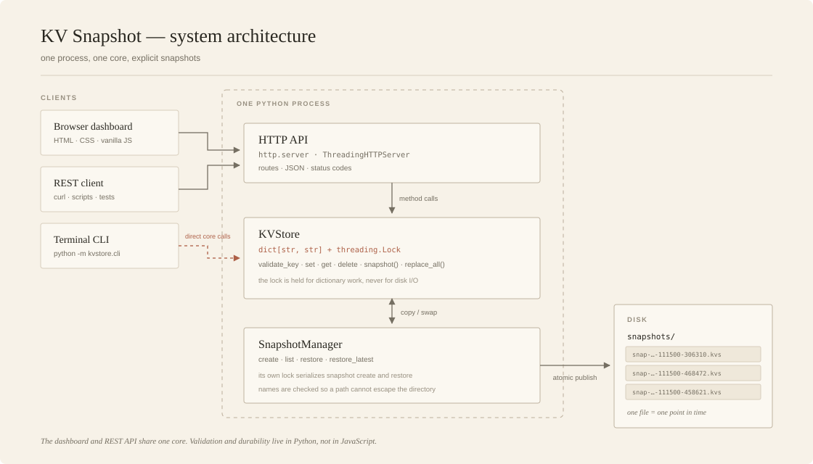
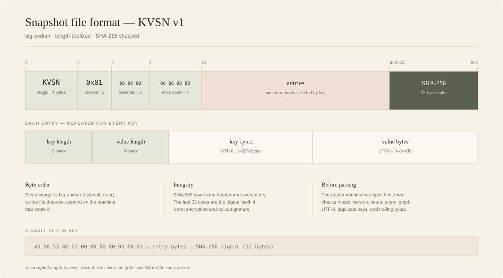
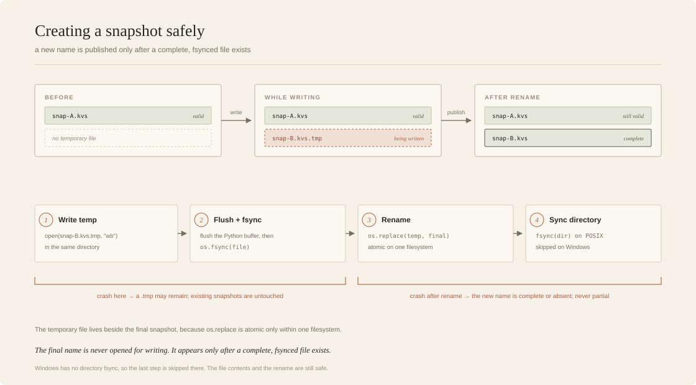
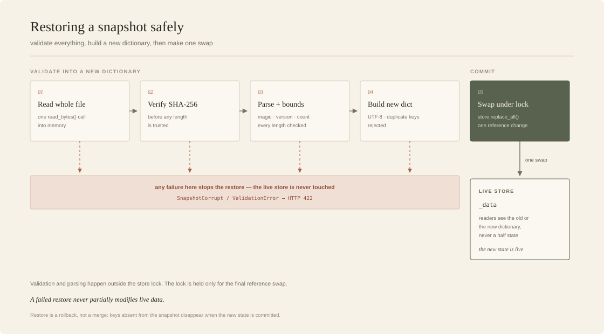

# Abstract

This report presents **KV Snapshot**, a small key–value store that keeps its
working data in memory and persists it through explicitly created, checksummed
snapshot files. The project focuses on one systems-programming question: how can
a program replace a complete data file without leaving a half-written file if
the process crashes, the disk fills, or the machine loses power?

The implementation answers that question with a strict write protocol: serialize
a consistent copy of the store, write it to a temporary file in the same
directory, flush and `fsync` the file, atomically rename it to its final unique
name, and (on POSIX) `fsync` the directory. Restore performs the reverse
carefully: read the complete file, verify magic bytes, version, lengths, UTF-8
encoding, and a SHA-256 trailer, parse into a new dictionary, and only then swap
it into the live store. A failed restore never changes live data.

The project includes a thread-safe in-memory store, a binary snapshot format, a
REST API built on Python's `http.server`, a browser dashboard, a command-line
client, and 72 automated tests, including disk-full, rename-failure,
corruption, truncation, concurrency, and path-traversal cases. All code uses the
Python standard library and runs on Windows, Linux, and macOS without installing
third-party packages.

# 1. Introduction

## 1.1 Problem

In-memory key–value stores are fast because they avoid disk access on every
operation. That speed creates a durability problem: when the process exits, the
data is gone. A common solution is to periodically write the complete state to a
file. The difficult part is not writing bytes; it is writing them **safely**.
A naïve implementation opens the target file and writes over it. If the process
is killed halfway through, the only copy of the data is now truncated and the
old version has already been destroyed.

This project avoids that trap in two ways. Every snapshot gets a new timestamped
name, and a new name is published only by an atomic rename after the file is
complete. Existing snapshots are never opened for writing, so they cannot be
damaged by a failed new snapshot.

The project must therefore provide two guarantees:

1. **Consistency:** a snapshot represents one point in time, even if other
   threads are writing while the snapshot is created.
2. **Failure isolation:** a failed snapshot or restore must not damage the
   previous valid snapshot or the live in-memory state.

## 1.2 Objectives

- Implement a thread-safe in-memory key–value store with create, read, update,
  delete, and list operations.
- Define a documented binary snapshot file format with a magic number, version,
  entry count, length-prefixed entries, and an integrity checksum.
- Write snapshots with an atomic replacement protocol.
- Restore only after complete validation, with no partial state changes.
- Expose the store through a REST API and an understandable graphical interface.
- Test normal behaviour and failure behaviour, not only the “happy path”.
- Produce documentation that allows every team member to explain the design.

## 1.3 Scope

The system is a single-process, local application. It does not implement user
accounts, network authentication, TLS, replication, or a query language. Those
are explicit non-goals: adding them would hide the operating-system ideas that
the project is meant to demonstrate.

# 2. Background

## 2.1 Memory versus durability

A Python dictionary gives average O(1) lookup and update. It is ideal for the
working set, but it exists only inside the process. A snapshot serializes the
dictionary into a file so that a later process can reconstruct it. The snapshot
is a **full copy**, not a write-ahead log; this keeps the format and recovery
logic simple enough to explain and test.

## 2.2 Atomic replacement

POSIX `rename(2)` (and Python's `os.replace`, which maps to it) atomically
changes a directory entry from one name to another when both names are on the
same filesystem. Readers see either the old file or the new file, never a
partially renamed file. The important consequence is that the temporary file
must be created in the **same directory** as the destination. A rename across
filesystems is a copy followed by a delete, which is not atomic.

Atomic rename protects the directory entry, but it does not, by itself, ensure
that the file contents have reached stable storage. The data must be flushed and
`fsync`ed before the rename. On POSIX, the directory entry also needs an
`fsync` so the rename survives a power loss.

## 2.3 Why `fsync` matters

`write()` normally copies data into the operating system's page cache. A process
crash does not lose that data because the kernel still owns it, but a power loss
can. `fsync(fd)` asks the kernel to transfer the file's data and metadata to the
storage device and wait for completion. Without it, a rename can be durable while
the new file's contents are still only in volatile cache.

The writer therefore performs:

```text
write temp file -> flush Python buffer -> fsync(file) -> rename -> fsync(directory)
```

Windows does not permit opening a directory as a normal file, so the directory
`fsync` step is skipped there. The code documents this platform difference rather
than pretending the guarantee is identical.

## 2.4 Checksums

A checksum detects accidental corruption: a flipped bit, a truncated transfer,
a bad sector, or a file edited by mistake. The project uses SHA-256 over every
byte before the trailer and stores the 32-byte digest at the end. SHA-256 is
overkill for accidental corruption compared with CRC32, but it is available in
Python's standard library, has no collision concerns at this scale, and is easy
to explain. It is **not** a signature: an attacker who can rewrite the file can
also recompute the checksum. Authentication would require a secret key or a
digital signature and is outside the scope.

# 3. Requirements

## 3.1 Functional requirements

| ID | Requirement |
| --- | --- |
| F1 | Insert or update a string key with a string value |
| F2 | Read one value, list all entries, and delete one key |
| F3 | Reject empty keys, control characters, and keys over 256 UTF-8 bytes |
| F4 | Reject values over 64 KiB |
| F5 | Create a snapshot of a consistent point in time |
| F6 | List available snapshots newest-first |
| F7 | Restore a snapshot only after complete validation |
| F8 | Provide a browser interface for all operations |
| F9 | Provide a REST API and a CLI using the same core |
| F10 | Survive restart by explicitly restoring a snapshot |

## 3.2 Non-functional requirements

| ID | Requirement |
| --- | --- |
| N1 | No third-party runtime dependencies |
| N2 | Thread-safe access from multiple HTTP client threads |
| N3 | A failed write leaves the previous snapshot intact |
| N4 | A failed restore leaves the live store unchanged |
| N5 | Snapshot names cannot escape the snapshot directory |
| N6 | Invalid input produces a clear 4xx error, not a crash |
| N7 | The project runs on Windows and Linux |
| N8 | Every core behaviour is covered by automated tests |

# 4. System Architecture



The system has five layers:

| Layer | File | Responsibility |
| --- | --- | --- |
| Dashboard | `kvstore/web/` | Display entries and snapshots; call the API; show errors |
| HTTP server | `kvstore/server.py` | Parse routes and JSON; map exceptions to status codes |
| Store | `kvstore/store.py` | Thread-safe dictionary and input validation |
| Snapshot engine | `kvstore/snapshot.py` | Binary format, checksum, atomic writer, safe restore |
| Disk | `snapshots/*.kvs` | Immutable snapshot files |

The GUI never touches files directly. Every operation goes through the API, and
the API calls the same `KVStore` and `SnapshotManager` objects used by the CLI.
This gives one implementation of each rule: validation is not duplicated in
JavaScript, and a bug fixed in the store is fixed for every client.

## 4.1 Read and write flow

A write request follows this path:

```text
browser -> POST /api/entries -> JSON validation -> KVStore.set()
        -> dictionary update under lock -> JSON response
```

The write is visible to other readers immediately. It is **not** durable until a
snapshot is created. This is an explicit design choice, and it is shown in the
dashboard subtitle and documentation.

A snapshot request follows this path:

```text
POST /api/snapshots -> SnapshotManager.create()
                    -> store.snapshot()   (copy under store lock)
                    -> encode_snapshot()  (outside store lock)
                    -> temp file, fsync, rename, fsync directory
                    -> JSON response
```

## 4.2 Concurrency model

The HTTP server is a `ThreadingHTTPServer`, so each request is handled by a
separate thread. Two locks protect shared state:

- **Store lock:** protects the dictionary for single operations and for the copy
  used by a snapshot.
- **Snapshot-manager lock:** serializes snapshot creation and restore so two
  writers cannot race on the same directory or on the live swap.

Disk I/O is never performed while the store lock is held. A snapshot copies the
dictionary in O(n), releases the lock, and then serializes the copy. This keeps
normal reads and writes responsive during snapshot creation.

A single lock is used instead of a reader–writer lock because the critical
sections are tiny and one lock is easier to prove correct. A custom reader–writer
lock would add complexity without a meaningful benefit at this scale.

# 5. Snapshot File Format



All integers are big-endian. The format is versioned and begins with a magic
number so that a random file is rejected immediately.

| Offset | Size | Field |
| --- | --- | --- |
| 0 | 4 | Magic bytes `KVSN` |
| 4 | 1 | Format version (`1`) |
| 5 | 3 | Reserved padding, zero |
| 8 | 4 | Number of entries |
| 12 | variable | Entries |
| end − 32 | 32 | SHA-256 of all preceding bytes |

Each entry is length-prefixed:

| Size | Field |
| --- | --- |
| 2 | Key length in bytes |
| 4 | Value length in bytes |
| key length | UTF-8 key bytes |
| value length | UTF-8 value bytes |

The checksum covers the header and every entry, but not itself. Sorting keys
before serialization makes output deterministic, which simplifies testing and
makes two equal stores produce equal files.

## 5.1 Why a binary format?

A JSON file would be easier to inspect, but a binary format makes the important
fields explicit and lets the reader validate lengths before allocating or
slicing. It also demonstrates byte-order and bounds-checking work that is hidden
by a serializer. The trade-off is that the file is not human-readable; the
`Format-Hex` demo and this document explain its structure.

## 5.2 Limits and validation

The reader rejects:

- files shorter than the 12-byte header plus the 32-byte checksum
- a checksum mismatch
- wrong magic bytes
- an unsupported version
- more than 100,000 entries
- key lengths of zero or more than 256
- value lengths over 64 KiB
- an entry whose lengths point past the end of the file
- invalid UTF-8
- duplicate keys
- trailing bytes after the last entry

The checksum is verified **before** entry parsing. This means corrupted lengths
are never trusted, even for one iteration.

# 6. Atomic Write Protocol



The writer in `write_snapshot_file()` performs five steps:

1. Encode the dictionary into one bytes object.
2. Open `snap-….kvs.tmp` in the same directory and write the bytes.
3. `flush()` the Python buffer, then `os.fsync()` the file descriptor.
4. `os.replace()` the temp file to the final unique name.
5. On POSIX, open the directory and `fsync` it.

If any step raises `OSError`, the temporary file is removed and a
`SnapshotWriteError` is raised. The old snapshot is never opened for writing, so
it cannot be damaged.

## 6.1 Crash matrix

| Crash point | State on disk | Recovery |
| --- | --- | --- |
| During `write()` to temp | All existing snapshots intact; temp may exist | Startup removes stale `.tmp` |
| After `fsync(file)` | Existing snapshots intact; complete temp | Startup removes temp; existing snapshots still valid |
| During `rename` | Existing snapshots intact; new name appears complete or not at all | Filesystem atomicity guarantees one complete directory entry |
| After rename, before directory `fsync` (POSIX) | Existing snapshots intact; the new name may or may not survive power loss | Either outcome is a complete file; no partial data |
| During restore | Live store unchanged until the swap | Error returned; old state remains |

A process crash is easier to survive than a power loss because the page cache
survives. The protocol is designed for the harder case and therefore also covers
the easier one.

## 6.2 Concurrent snapshots

`SnapshotManager.create()` holds the manager lock for the whole create
operation. Two simultaneous requests are therefore serialized. The alternative
would be to return `409 Conflict`, but serializing is simpler and snapshots are
fast relative to human interaction. Reads and writes continue during the file
write because the store lock is released before serialization.

## 6.3 Stale temporary files

A crash can leave a `.tmp` file. `SnapshotManager.__init__` scans the directory
for `*.tmp` and deletes them. A temp file is never a valid snapshot: the real
name is only created by the atomic rename, and restore only accepts names ending
in `.kvs`.

# 7. Safe Restore



Restore is intentionally conservative:

1. Reject a name containing a path separator or not ending in `.kvs`.
2. Resolve the file inside the manager's directory.
3. Read the **entire** file into memory.
4. Verify the SHA-256 checksum.
5. Parse the header, magic, version, and entry count.
6. Bounds-check every length before slicing.
7. Decode and validate every key and value.
8. Build a new dictionary.
9. Only after all steps succeed, call `store.replace_all()`.

`replace_all()` validates the complete dictionary before taking the store lock,
then swaps the dictionary reference under the lock. If any step before the swap
fails, the live dictionary is untouched.

## 7.1 Restore semantics

Restore is a **rollback**, not a merge. Keys that exist now but not in the
snapshot disappear; keys in the snapshot return. The GUI confirmation text says
this explicitly. Because the whole dictionary is swapped, writes that complete
during validation are discarded; writes that arrive after the swap operate on
the restored state. This is the expected meaning of “replace the live state with
this snapshot.”

# 8. Implementation Walkthrough

## 8.1 The store

The store is a dictionary plus a lock:

```python
def set(self, key: str, value: str) -> bool:
    key = validate_key(key)
    value = validate_value(value)
    with self._lock:
        created = key not in self._data
        self._data[key] = value
        return created
```

Validation occurs outside the lock because it uses only the arguments. The
check-and-set happens inside the lock so the return value is accurate even with
concurrent writers. `items()` copies the items under the lock and sorts the copy
after releasing it, so sorting does not block writers.

`snapshot()` is the key concurrency primitive:

```python
def snapshot(self) -> dict[str, str]:
    with self._lock:
        return dict(self._data)
```

The copy is consistent because no writer can mutate the dictionary while the
copy is being built. The lock is released before encoding or disk I/O.

## 8.2 Encoding and decoding

`encode_snapshot()` validates every entry, sorts the keys, writes the 12-byte
header, then each entry header and its UTF-8 bytes. It appends the SHA-256 of the
body.

`decode_snapshot()` starts by splitting the last 32 bytes from the body and
comparing hashes with `hmac.compare_digest`. It then unpacks the fixed header,
checks the magic/version/count, and walks the entries with an explicit offset.
Every length is checked against the remaining body size before slicing.

## 8.3 The atomic writer

```python
with open(temp_path, "wb") as handle:
    handle.write(data)
    handle.flush()
    os.fsync(handle.fileno())

os.replace(temp_path, path)
_fsync_directory(path.parent)
```

The `with` block closes the file even on failure. The `except OSError` block
attempts to unlink the temp file and then raises a project-specific error. The
destination path is never opened with `"w"`, which is the critical difference
from a naïve implementation.

## 8.4 Snapshot manager

The manager owns the directory and the lock. `create()` takes a store copy,
generates a UTC timestamp name, writes the file, and returns metadata.
`restore()` resolves and validates the name, reads and parses the complete file,
then swaps the state. `list()` reads only the 12-byte header for the dashboard;
the full checksum is deferred until restore.

File names are generated as
`snap-YYYYMMDD-HHMMSS-microseconds.kvs`, with a numeric suffix if a collision
occurs. UTC is used so names sort naturally and are unambiguous across machines.

## 8.5 HTTP API

`server.py` uses `BaseHTTPRequestHandler` and `ThreadingHTTPServer`. Routing is a
small explicit set of `if` statements rather than a framework. Each handler calls
the store or manager directly. A shared `_dispatch()` method maps exceptions:

| Exception | HTTP response |
| --- | --- |
| `ValidationError` | 400 `validation_error` |
| `KeyNotFound`, `SnapshotNotFound` | 404 `not_found` |
| `SnapshotCorrupt` | 422 `snapshot_corrupt` |
| `SnapshotWriteError` | 500 `snapshot_write_error` |
| unexpected exception | 500 `internal_error` (traceback on server console) |

The API sets `Content-Length` on every response, uses JSON error objects, and
serves the dashboard from fixed file names. A Content-Security-Policy restricts
the page to its own scripts and styles. There is no CORS configuration because
the dashboard is same-origin and the server binds to localhost by default.

## 8.6 Browser dashboard

The dashboard is plain HTML, CSS, and JavaScript. It loads `/api/status`,
`/api/entries`, and `/api/snapshots` in parallel, renders the table with DOM
APIs, and uses `textContent` for every user value. Avoiding `innerHTML` for user
data prevents stored XSS.

The interface makes the durability model visible: the subtitle says changes are
in memory, the snapshot card shows file names and sizes, and the activity panel
records session actions. Restore and delete actions require confirmation.

## 8.7 CLI

`cli.py` uses `shlex.split()` so quoted values with spaces work. It calls the
same store and manager. It is useful when a projector, browser, or HTTP port is
unavailable, and it proves the core is independent of the web layer.

## 8.8 Why Python?

The assignment is about operating-system behaviour: memory, locks, file
descriptors, `fsync`, rename atomicity, byte layouts, and error handling. Python
exposes all of these directly through `os` and `open`, while keeping the code
short enough to explain without pointer arithmetic. The design is
language-independent; the same protocol would be used in C or Go. Python's GIL
does not make a compound operation such as “check then write” atomic, so the
explicit store lock is still required and still meaningful.

# 9. API Design

The complete contract is in `docs/API.md`. The main endpoints are:

| Method | Path | Result |
| --- | --- | --- |
| GET | `/api/health` | liveness |
| GET | `/api/status` | counts, data directory, latest snapshot |
| GET | `/api/entries` | list entries |
| GET | `/api/entries/{key}` | one value |
| POST | `/api/entries` | create/update |
| DELETE | `/api/entries/{key}` | delete |
| GET | `/api/snapshots` | list files |
| POST | `/api/snapshots` | create snapshot |
| POST | `/api/restore` | restore by file name |

Example:

```bash
curl -X POST http://127.0.0.1:8080/api/entries \
  -H "Content-Type: application/json" \
  -d '{"key":"owner","value":"Seif"}'
```

All successful responses include `"ok": true`. All failures include a stable
`error.code` and a human-readable message. Validation is performed in the store,
not only in the GUI, so a direct API call cannot bypass the limits.

# 10. Testing and Evaluation

## 10.1 Strategy

The tests are organized by the layer they exercise, plus a dedicated
failure-injection file. The goal is not only to show that the happy path works,
but to prove that the safety claims hold when the operating system returns
errors.

| Test file | Tests | Focus |
| --- | ---: | --- |
| `tests/test_store.py` | 18 | validation, CRUD, copies, concurrent reads/writes |
| `tests/test_snapshot.py` | 28 | binary format, malformed files, manager, path safety |
| `tests/test_failure_modes.py` | 8 | disk full, rename failure, corruption, concurrency |
| `tests/test_api.py` | 18 | HTTP CRUD, errors, snapshots, static dashboard |
| **Total** | **72** | |

Run with:

```bash
python -m unittest discover -s tests -v
```

## 10.2 Failure injection

The failure tests use `unittest.mock.patch` to inject operating-system errors:

- `os.fsync` raises `OSError(28, "No space left on device")`.
- `os.replace` raises `OSError("permission denied")`.
- A snapshot byte is flipped to break the checksum.
- A snapshot is truncated.
- A stale `.tmp` file is left before manager startup.
- Four threads create snapshots concurrently.
- A writer thread mutates the store while a snapshot is being created.

The assertions check not only that an exception was raised, but that the previous
snapshot bytes are unchanged, the live store is unchanged, the temporary file is
gone, and all concurrent snapshots are valid.

## 10.3 Manual verification

The dashboard was exercised in a real browser: create, edit, delete, snapshot,
restore, corrupt-file restore, search, and keyboard shortcuts. The CLI was
exercised with quoted values, snapshot creation, listing, and restore. A server
restart with `--load-latest` was also verified.

## 10.4 Results

- All 72 automated tests pass under Python 3.12 on Windows.
- The CI workflow runs the same suite on Ubuntu and Windows with Python 3.10 and
  3.12.
- No third-party packages are required.
- The dashboard loads with no JavaScript console errors.
- Corrupt snapshots produce a clear 422 response and leave live data intact.

## 10.5 What the tests do not prove

The tests simulate errors at the Python API boundary; they do not physically cut
power to a disk. True power-loss testing requires fault-injecting filesystems or
hardware. The protocol follows the POSIX ordering rules, but an empirical power
test is outside the scope of a course project. This limitation is stated
explicitly rather than hidden.

# 11. Edge Cases

| Scenario | Handling |
| --- | --- |
| Disk full during snapshot | Temp file removed; old snapshot and live store intact; 500 error |
| Crash mid-write | Startup deletes stale `.tmp`; old snapshot remains valid |
| Checksum mismatch | Restore rejected with 422 before parsing; live state unchanged |
| Truncated/wrong format | Bounds and header checks reject the file; no partial parse |
| Missing snapshot | 404 with a clear message; no crash |
| Invalid GUI input | GUI checks; store/API re-check and return 400 |
| Concurrent snapshot and write | Copy under lock; consistent point-in-time file |
| Permission denied | `OSError` wrapped as `SnapshotWriteError`; 500 response |
| Two snapshots at once | Manager lock serializes; both files valid |
| Path traversal in filename | `Path(name).name` check and resolved parent check; 400 |
| Stale temp file | Removed on manager startup |
| Oversized value | Rejected at 64 KiB with 400 |
| Unicode | UTF-8 round-trip tested with Arabic and emoji |
| Windows directory `fsync` | Skipped with documented weaker guarantee |

# 12. Limitations and Future Work

- **Single process:** there is no replication or shared storage between
  processes.
- **No automatic snapshot policy:** the user chooses when to snapshot. A future
  version could snapshot every N writes or on shutdown.
- **No retention policy:** old snapshots accumulate. A future version could keep
  the newest N and delete older files safely.
- **Full-file snapshots:** each snapshot copies the whole store. For a much
  larger store, an append-only log plus compaction would be more efficient.
- **No encryption or signatures:** the checksum detects corruption, not
  malicious modification.
- **Windows durability:** directory `fsync` is not available, so the rename's
  power-loss guarantee is weaker than on POSIX.
- **No authentication:** the server is local-only by default.

# 13. Team Roles

The team followed a layered split so that each person could own a file or a
vertical slice without blocking others. The full table is in
`docs/TEAM.md`; final names and percentages are filled in through
`docs/team.json` before submission.

| Role | Responsibility |
| --- | --- |
| Team Lead / Integrator | Architecture, interfaces, integration, reviews |
| KV Store Developer | Dictionary, validation, locking |
| Snapshot Writer | Encoding, temp file, `fsync`, rename |
| Restore & Validation | Checksums, parsing, safe swap |
| API Developer | Routes, JSON, status codes |
| GUI Developer 1 | Table, add/edit/delete |
| GUI Developer 2 | Snapshot controls, errors, responsive layout |
| QA Lead | Test plan, failure injection, acceptance |
| QA / Tester | Unit/integration tests, CI, clean build |
| Documentation Lead | Report, README, diagrams, demo |

### 13.1 Team members

> Names and contribution percentages are maintained in `docs/team.json`.

<!-- TEAM_TABLE -->

# 14. Conclusion

KV Snapshot demonstrates that durability is an ordering problem, not just a
file-writing problem. The project combines a simple in-memory data structure
with a carefully ordered snapshot protocol: a consistent copy, a same-directory
temp file, `fsync`, atomic rename, and directory `fsync`. Restore reverses the
process with full validation before any live state changes. The result is a
small system whose normal path is easy to explain and whose failure paths are
explicitly tested.

The implementation deliberately avoids third-party frameworks so that every
layer—store, format, writer, restore, API, and GUI—can be inspected and
defended. The 72 tests, including injected disk and rename failures, show that
the safety claims are not only comments in the code.

# Appendix A: Running the Project

```bash
# Dashboard with sample data
python -m kvstore --demo --open

# Normal start
python -m kvstore

# Restore newest snapshot on startup
python -m kvstore --load-latest

# CLI
python -m kvstore.cli

# Tests
python -m unittest discover -s tests -v
```

Requirements: Python 3.10 or newer. No `pip install` step.

# Appendix B: Short Viva Answers

| Question | Short answer |
| --- | --- |
| Why copy before snapshot? | To get a consistent point in time without holding the store lock during disk I/O |
| Why not write directly to the snapshot? | A crash would truncate the only valid copy; temp + rename preserves the old file |
| Why same directory? | `os.replace` is atomic only within one filesystem |
| Why `fsync` the file? | To move data from the page cache to stable storage before rename |
| Why `fsync` the directory? | To make the rename itself durable on POSIX |
| Why checksum before parsing? | Never trust corrupted length fields; reject early |
| Why build a new dict on restore? | To avoid partial mutation of live state if parsing fails |
| Why a lock if Python has a GIL? | The GIL does not make compound check-then-write operations atomic |
| Why not SQLite? | The project is about implementing the snapshot protocol, not using a database |
| What happens on disk full? | Temp is removed, old snapshot and live store remain, API returns 500 |
| What happens on bad checksum? | 422, live store untouched |
| Is the checksum encryption? | No, it detects accidental corruption only |

A longer guide with 30 questions and live-modification exercises is in
`docs/CODE_GUIDE.md`.

# Appendix C: File Map

| Path | Purpose |
| --- | --- |
| `kvstore/store.py` | Dictionary, validation, lock |
| `kvstore/snapshot.py` | Format, checksum, atomic writer, restore |
| `kvstore/server.py` | REST API and static dashboard server |
| `kvstore/cli.py` | Interactive terminal client |
| `kvstore/web/index.html` | Dashboard layout |
| `kvstore/web/style.css` | Dashboard design and responsive rules |
| `kvstore/web/app.js` | API calls, rendering, dialogs, activity log |
| `tests/` | 72 automated tests |
| `docs/` | Report, API contract, demo script, code guide, slides |
| `tools/build_docs.py` | Regenerates PDFs and slides from Markdown/JSON |
| `.github/workflows/ci.yml` | CI on Ubuntu and Windows |

# References

1. A. Silberschatz, P. B. Galvin, and G. Gagne, *Operating System Concepts*,
   10th ed., Wiley, 2018.
2. Python Software Foundation, “`os.replace`,” “`os.fsync`,” and “`open`,”
   Python 3 documentation.
3. Linux man-pages project, `fsync(2)` and `rename(2)`.
4. LWN.net, “Ensuring data reaches disk,” <https://lwn.net/Articles/457667/>.
5. NIST, “Secure Hash Standard (SHS),” FIPS PUB 180-4, 2015.
6. SQLite, “Atomic Commit In SQLite,” <https://www.sqlite.org/atomiccommit.html>.
